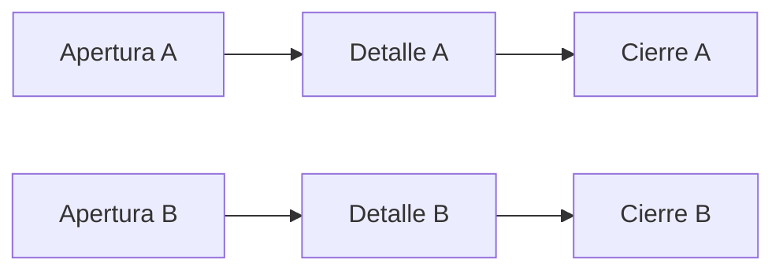
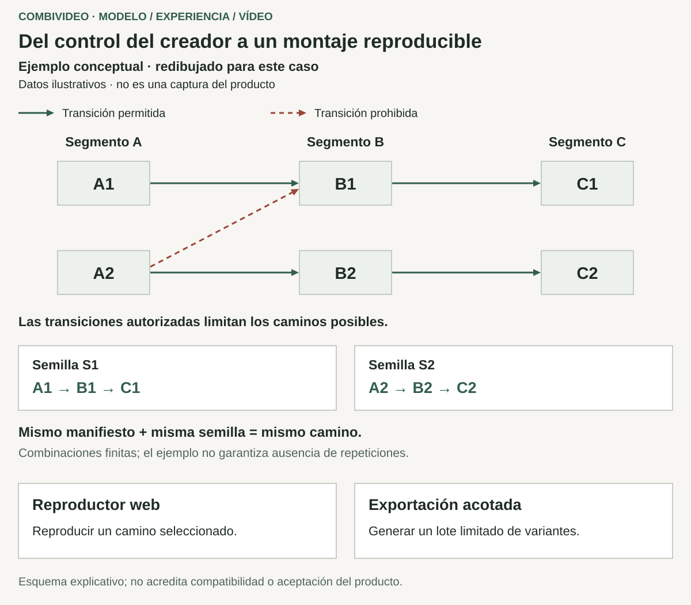
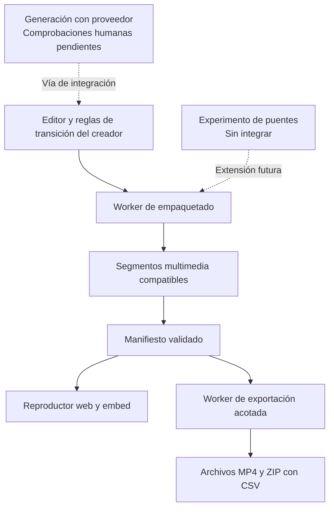

# combivideo: combinaciones controladas por el creador y vídeo reproducible

[Volver al perfil](../README.md) · [English](combivideo.md)

**Proyecto personal experimental · definición de producto, UX para creadores e ingeniería multimedia**  
**Fecha de corte: 29 de octubre de 2026**

combivideo convierte clips alternativos en un conjunto de montajes permitidos. El creador define segmentos, variantes y transiciones; un mismo proyecto puede reproducir distintas combinaciones en la web o exportar archivos de vídeo convencionales. Una semilla permite reproducir el camino elegido con el mismo manifiesto.

Este MVP experimental incluye herramientas de autor, reproducción, empaquetado y exportación implementadas. Exportación y embed conservan aceptación fechada; otras comprobaciones de navegador, remotas y humanas siguen pendientes. El código permanece privado; el caso utiliza diagramas explicativos.

## Mi responsabilidad y la idea inicial

Un amigo describió la idea inicial de escenas alternativas que cambian entre reproducciones. Mi aportación fue investigar la viabilidad, definir el producto y sus restricciones, diseñar la experiencia de edición y desarrollar el software. Utilicé asistencia de IA en investigación, implementación y revisión, con herramientas y librerías existentes. Las decisiones se refinaron durante ese proceso; no reivindico la invención exclusiva de la idea o las primitivas multimedia.

## El problema de producto

Un creador puede necesitar varias versiones de un mismo metraje y conservar el control sobre qué escenas pueden seguirse. Una web puede alojar un reproductor variable; las plataformas sociales generalmente reciben vídeos exportados convencionales. Son necesidades de distribución distintas que parten de un mismo proyecto.

La dificultad consiste en hacer comprensibles las combinaciones y permitir su reproducción técnica. Un límite de códec válido no acredita una historia creíble. Un espacio grande de caminos posibles también genera costes de exportación, transferencia y procesamiento. Estas distinciones dieron forma al modelo y a la interfaz.

## Decisiones que dieron forma al producto

### 1. Dar al creador el control de la coherencia

Adopté un grafo por capas: cada segmento temporal contiene variantes y las aristas permitidas indican qué puede seguir a qué. Una matriz de intercambiabilidad permite al creador restringir transiciones sin editar un grafo de propósito general. La interfaz puede mostrar el conteo resultante y el camino seleccionado.

Así se mantienen explícitas las decisiones editoriales, a cambio de pedir al creador que autorice las combinaciones. La inferencia narrativa automática permanece fuera del producto implementado. El siguiente ejemplo ficticio contiene únicamente las transiciones dibujadas: Apertura B no puede llevar a Detalle A.

Los caminos son finitos. Una semilla reproduce una elección con el mismo manifiesto; otra semilla no garantiza una combinación históricamente inédita.

### 2. Utilizar un modelo común para reproducir y exportar

Un manifiesto tipado y validado traslada segmentos, variantes, transiciones y reglas de selección entre editor, reproductor y worker de exportación. Compartir el significado reduce el riesgo de que la vista previa, la reproducción y la exportación por lotes interpreten el proyecto de forma distinta. También permite ofrecer reproducibilidad y nombres de archivo trazables al creador.

La contrapartida es mantener un contrato versionado en cada frontera. La implementación incluye enumeración acotada para espacios pequeños y muestreo reproducible con límites para los mayores. Evita intentar todos los caminos por defecto; es control del coste, no un benchmark demostrado a escala comercial.

### 3. Preparar la continuidad durante la codificación

El pipeline de empaquetado normaliza los clips a un perfil compatible, duración de segmento y límites decodificables de forma independiente. El reproductor implementado utiliza MSE/MMS directamente con un único SourceBuffer, con una alternativa de vídeo estático cuando procede. Preparar esas condiciones durante la codificación reduce las reparaciones que se esperan de la reproducción.

La elección añade procesamiento y validación de medios antes de publicar. No garantiza suavidad perceptiva para cualquier entrada ni soporte en todos los dispositivos. La verificación física en iPhone sigue pendiente y la continuidad técnica permanece separada de la coherencia narrativa.

### 4. Separar la edición rápida del procesamiento definitivo

El editor ofrece una vista previa aproximada con los clips de origen, mientras la publicación solicita el empaquetado final. Esto permite recibir respuesta durante la edición sin completar una codificación tras cada cambio. El coste es mantener explícita la diferencia entre la vista previa durante la edición y el contrato del medio publicado.

El procesamiento largo se ejecuta en un worker con reclamaciones atómicas de trabajo, concesiones temporales, recuperación e intentos acotados. La exportación conserva resultados por combinación, archivos MP4 y entrega ZIP/CSV, de modo que una combinación fallida puede comunicarse sin descartar los archivos correctos. Estos mecanismos no acreditan efectos exactamente una vez en servicios externos.

### 5. Tratar la generación como una extensión con aceptación propia

La capa de proveedores utiliza claves del usuario y separa la generación del modelo central de combinaciones. Existe código para este recorrido, pero siguen pendientes las comprobaciones humanas completas de gestión de claves, confirmación de coste y generación hasta publicación y reproducción.

Un experimento posterior exploró generar solo un puente entre los clips existentes del usuario. El ensayo de septiembre de 2026 documentó el anclaje visual y un límite narrativo: una transición no puede aportar hechos ausentes del metraje de destino. La extensión de puentes sigue sin integrar; es un aprendizaje de investigación, no una capacidad entregada.

## UX y estructura del sistema

La matriz, el camino y el conteo muestran el espacio permitido. La exportación distingue lotes y muestreo; sus metadatos identifican el camino de cada archivo. Siguen pendientes comprobaciones visuales y remotas.

Esta ilustración es una reconstrucción explicativa con contenido ficticio. No es un prototipo original, una pantalla de producción ni una demostración de aceptación visual actual.

Los recorridos continuos resumen implementación; los discontinuos conservan fronteras de integración y validación. No acreditan aceptación operativa completa.

## Estado de entrega

| Parte | Evidencia alcanzada | Límite pendiente |
| --- | --- | --- |
| Manifiesto y reproductor | Implementados, con comprobaciones históricas de comportamiento y navegador | Validación física en iPhone y cobertura de más dispositivos |
| Pipeline de empaquetado | Worker y recorrido local implementados | Comprobaciones de entrega remota |
| Editor y cuentas | Estructura, carga, matriz, vista previa y recorrido de publicación implementados | Ciclo completo publicar–ver, revisión visual y guardado automático remoto en Safari |
| Exportación y embed | Aceptación registrada el 8 de julio de 2026 de MP4, ZIP/CSV, reproducibilidad y embed externo | Evidencia histórica de ese recorrido, no aceptación completa de un SaaS |
| Generación con claves del usuario | Código y verificación de adaptadores documentados | Recorridos humanos de claves, coste y generación hasta reproducción |
| Puentes, facturación, analítica y personalización | Experimento de puente documentado el 28 de septiembre; las demás funciones son trabajo futuro | No se afirma un puente integrado ni un servicio comercial operativo |

## Evidencia y aprendizajes

El relato se apoya en decisiones fechadas, revisión de fuentes, pruebas focales, comprobaciones de medios y registros históricos de aceptación. Las comprobaciones originales de la aplicación no se reejecutaron para este caso y los cambios locales posteriores no se tratan como entrega aceptada. No se atribuyen resultados de adopción, ingresos o rendimiento publicitario.

El aprendizaje conecta control creativo, caminos finitos, elecciones reproducibles, segmentos compatibles y salidas acotadas. La entrega completa sigue requiriendo observación en su dispositivo objetivo.
