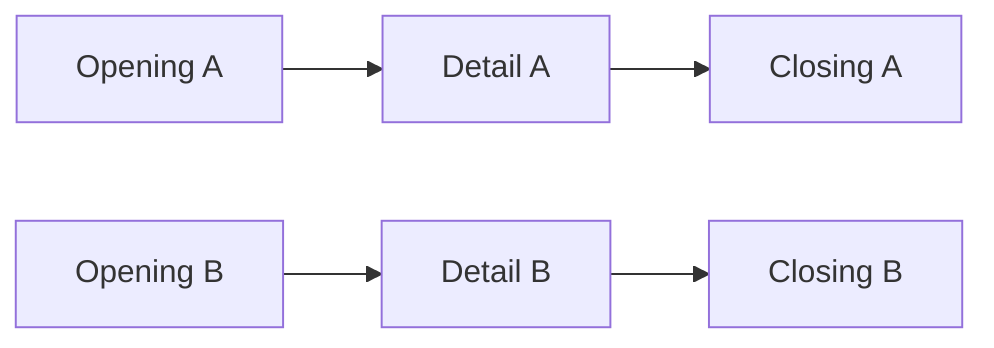
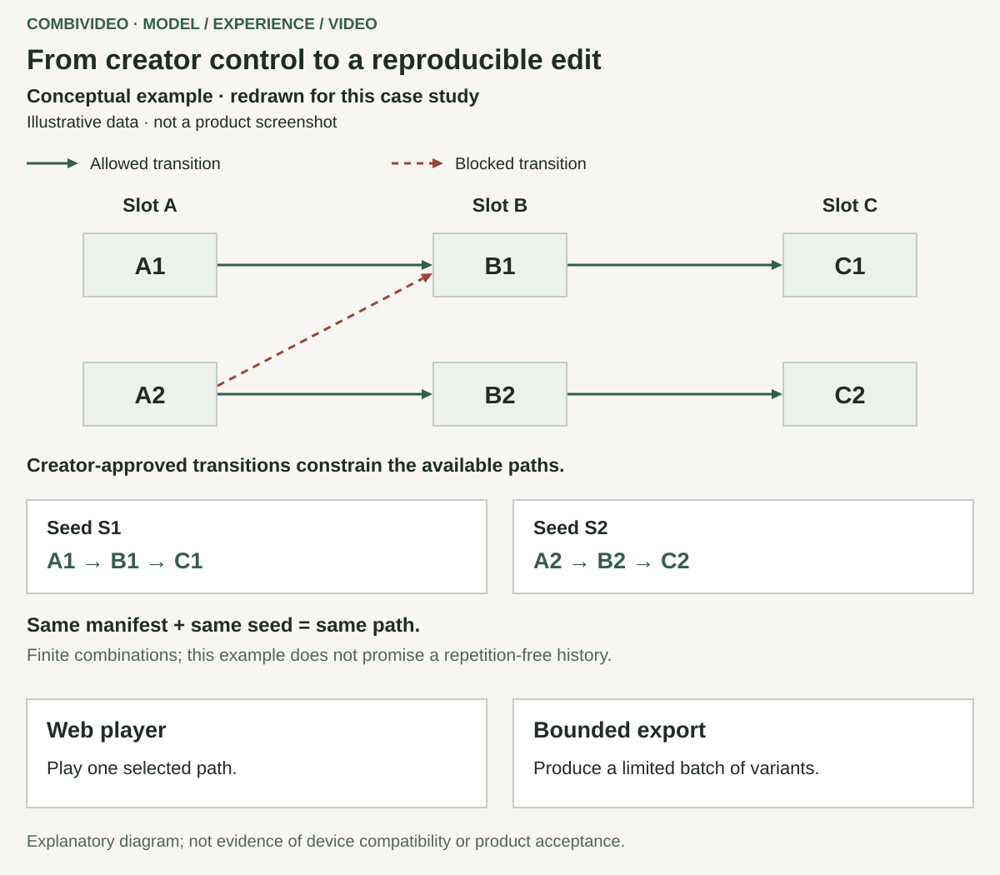
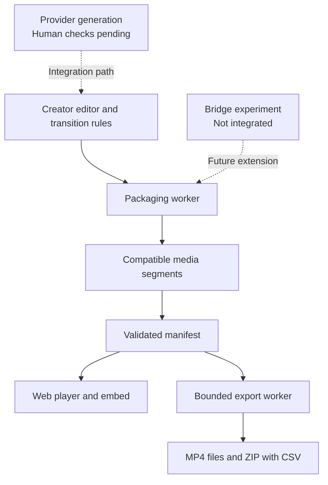

# combivideo: creator-controlled combinations and reproducible media

[Back to profile](../README.md) · [Español](combivideo.es.md)

**Personal experimental project · product definition, authoring UX and multimedia engineering**  
**Status snapshot: 29 October 2026**

combivideo turns alternative clips into a set of permitted montages. A creator defines the segments, variants and transitions; the same project can play different combinations on the web or export flat video files. A seed makes a chosen path reproducible for the same manifest.

This experimental MVP has implemented authoring, playback, packaging and export components. Export and embed have dated acceptance evidence; other browser, remote and human checks remain open. The source stays private; this case uses explanatory diagrams.

## My responsibility and the starting idea

A friend described the original idea of alternative scenes changing between plays. My contribution was feasibility research, product definition, constraints, authoring UX and development. I used AI-assisted research, implementation and review with established media tools and libraries. Decisions were refined through that process; I do not claim exclusive invention of the idea or media primitives.

## The product problem

A creator may want several versions of one piece of footage, while retaining control over which scenes can follow each other. A website can host a variable player; social platforms generally receive ordinary exported videos. Those are different delivery needs from one underlying project.

The difficult part is making combinations understandable and technically playable. A valid codec boundary does not establish a believable story. A large number of possible paths also creates export, bandwidth and processing costs. These distinctions shaped the model and interface.

## Decisions that shaped the product

### 1. Give the creator control over coherence

I adopted a layered graph: each timeline segment contains variants, and permitted edges describe what can follow what. An interchangeability matrix lets the creator constrain transitions without editing a general-purpose graph. The interface can show the resulting count and selected path.

This keeps editorial decisions explicit, at the cost of asking the creator to authorize combinations. Automatic narrative inference remains outside the implemented product. The following fictional example contains only the shown transitions: Opening B cannot lead to Detail A.

The paths are finite. A seed reproduces a choice for an unchanged manifest; another seed does not guarantee a historically unique combination.

### 2. Use one model for playback and export

A typed, validated manifest carries segments, variants, transitions and selection rules across the editor, player and export worker. Shared meaning reduces the chance that preview, playback and batch export interpret a project differently. It also makes reproducibility and traceable filenames useful to creators.

The trade-off is maintaining a versioned contract at each boundary. The implementation includes bounded enumeration for small spaces and reproducible sampling with limits for larger ones. It avoids attempting every path by default; this is cost control rather than a demonstrated commercial-scale benchmark.

### 3. Prepare continuity during encoding

The packaging pipeline normalizes clips to a compatible profile, segment duration and independently decodable boundaries. The implemented player uses MSE/MMS directly with one SourceBuffer, with a static-video fallback where needed. Preparing these conditions during encoding reduces the repair work expected from playback.

That choice adds processing and media validation before publication. It does not guarantee perceptually smooth results for every input or support on every device. Physical iPhone verification remains pending, and technical continuity stays distinct from narrative coherence.

### 4. Separate fast authoring from final processing

The editor offers an approximate preview using source clips, while publication requests the final packaging work. This gives creators feedback while editing without requiring a complete encode after every change. The cost is an explicit difference between authoring preview and the published media contract.

Long-running media work runs in a worker with atomic claims, leases, recovery and bounded attempts. Export supports per-combination results, MP4 files and ZIP/CSV delivery, so one failed combination can be reported without discarding successful files. These mechanisms do not establish exactly-once effects for external services.

### 5. Make generation an extension with its own acceptance boundary

The provider layer uses the user's own keys and separates generation from the core combination model. Code exists for this path, but complete human checks for key handling, cost confirmation and generation through publication/playback remain pending.

A later experiment explored generating only a bridge between the user's existing clips. The September 2026 trial documented visual anchoring and a narrative limitation: a transition cannot supply facts missing from the destination footage. The bridge extension remains unintegrated; it is a research finding, not a shipped capability.

## UX and system structure

The matrix, path and count expose the allowed space. Export controls distinguish batches from sampling; metadata identifies each file's path. Visual and remote acceptance checks remain open.

This illustration is an explanatory reconstruction with fictional content. It is not an original prototype, production screen or demonstration of current visual acceptance.

Solid paths summarize implementation; dashed paths retain integration and validation boundaries. Neither establishes complete operational acceptance.

## Delivery state

| Part | Evidence reached | Remaining boundary |
| --- | --- | --- |
| Manifest and player | Implemented, with historical behavior and browser checks | Physical iPhone validation and broader device coverage |
| Packaging pipeline | Worker and local flow implemented | Remote delivery checks |
| Editor and accounts | Structure, upload, matrix, preview and publication flow implemented | Complete publish-to-watch, visual and remote Safari autosave checks |
| Export and embed | Acceptance recorded on 8 July 2026 for MP4, ZIP/CSV, reproducibility and external embed | This is historical evidence for that slice, not complete SaaS acceptance |
| Generation using user-provided keys | Code and adapter-level verification documented | Human key, cost and generation-to-playback journeys |
| Bridges, billing, analytics and personalization | Bridge experiment documented on 28 September; wider features remain future work | No integrated bridge or operational commercial service claimed |

## Evidence and lessons

The account rests on dated decisions, source review, focused tests, media checks and historical acceptance records. Those original application checks were not rerun for this case, and newer local changes are not treated as accepted delivery. No adoption, revenue or advertising-performance outcome is claimed.

The lesson connects creative control with finite paths, reproducible choices, compatible segments and bounded outputs. Complete delivery still needs observation on its target device.
