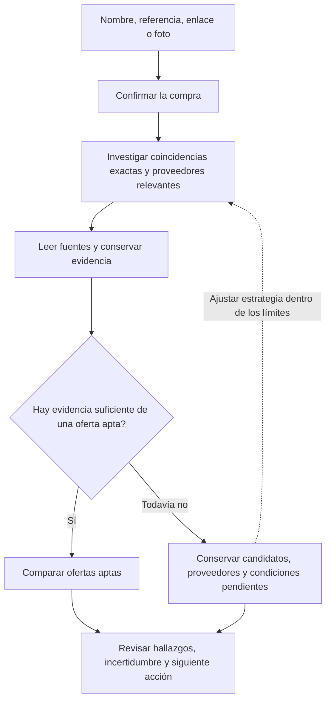
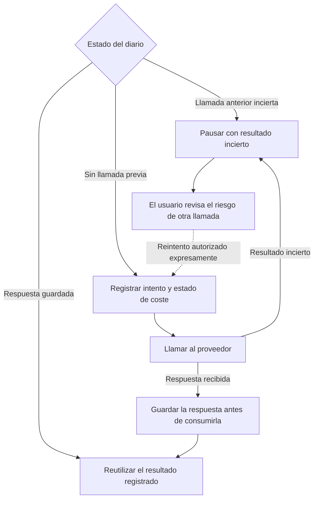
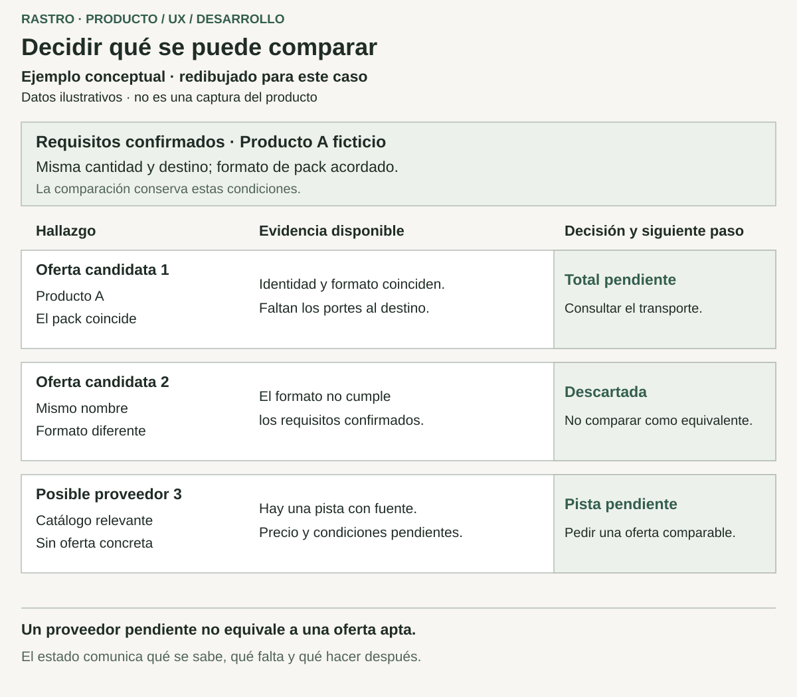

# Rastro: investigación de compras con evidencia y recuperación

[Volver al perfil](../README.md) · [English](rastro.md)

**Proyecto personal · definición de producto, UX de investigación y desarrollo full-stack**  
**Fecha de corte: 29 de octubre de 2026**

Rastro es una aplicación local para investigar productos y proveedores. Convierte un nombre, referencia, enlace o fotografía en una ficha de compra que el usuario confirma y presenta hallazgos con evidencia y condiciones pendientes. Su reto central es explicar una decisión cuando identidad, compatibilidad, entrega y costes siguen siendo inciertos.

El motor adaptativo, la interfaz de revisión y la ejecución persistente están implementados, con registros de verificación histórica. La utilidad comercial y las búsquedas reales amplias siguen pendientes de validar. El recorrido profesional completo es un siguiente incremento documentado. El código de aplicación y los registros de compras permanecen privados.

## Mi responsabilidad

Definí problemas, prioridades y criterios de utilidad, y desarrollé la aplicación con asistencia de IA para investigación, diseño, implementación y revisión. Mi aportación incluye convertir fallos de compra en un modelo, definir la experiencia de revisión e integrar ejecución persistente. Los modelos y servicios de proveedores son externos; este caso no atribuye cada algoritmo o técnica exclusivamente a mí.

## El problema de producto

Un nombre parecido o un precio anunciado bajo no acreditan una compra útil. Un componente puede ser incompatible, una página describir otro pack o quedar pendientes el transporte y el acceso profesional. Un especialista relevante puede merecer una consulta aunque no exista oferta con precio.

El producto debe conservar distinciones que un resumen puede ocultar: identidad, compatibilidad, presentación y aptitud comercial. Debe ayudar a entender la pregunta pendiente y la siguiente acción, junto con la evidencia disponible.

## Decisiones que dieron forma al producto

### 1. Definir el éxito según la compra real del usuario

Fijé la dirección profesional en mejorar el coste comparable al que compra una tienda. Un descuento respecto al precio público no acredita esa mejora. El modelo existente contempla cantidades, packs y algunas condiciones recurrentes; el recorrido B2B completo, con reventa, escenarios de volumen y presupuestos de proveedores, sigue pendiente. La decisión da un objetivo claro al siguiente incremento sin presentarlo como ahorro conseguido.

### 2. Confirmar la compra antes de investigarla

El usuario revisa qué necesita: producto o componente, elementos incluidos y excluidos, cantidad, formatos admitidos, estado, destino y urgencia. Las preguntas sectoriales distinguen un producto de peluquería de una pieza de taller. Esto añade una confirmación, pero evita tratar una entrada ambigua como requisito cerrado. La identificación puede ayudar al usuario; no sustituye su confirmación.

### 3. Distinguir candidatos, proveedores y ofertas aptas

La investigación puede ampliarse desde coincidencias exactas a especialistas, fuentes alternativas y proveedores que puedan presupuestar, según los hallazgos y límites. Elegí conservar pistas útiles con sus condiciones pendientes en lugar de dar estado de oferta a toda página descubierta. El informe registra fuentes, motivos y siguientes acciones; el conocimiento acotado y las correcciones conservan historial. Esto exige explicar más estados, pero mantiene por qué un resultado es utilizable, incierto o descartado.

Esquema del motor implementado; no garantiza encontrar una oferta apta.

### 4. Comparar el pedido conservando los costes desconocidos

La comparación contempla packs completos, cantidades, impuestos, transporte, mínimos, moneda y condiciones relevantes. Precio de producto y total del pedido entregado tienen significados distintos. La falta de evidencia deja pendiente el total correspondiente; un ahorro necesita una referencia comparable. Esto limita cuándo la interfaz puede dar una respuesta definitiva, pero facilita evaluarla. Un cálculo exacto no compensa identificar mal un producto o utilizar un dato sin confirmar.

### 5. Tratar una llamada pagada incierta como decisión de recuperación

La investigación utiliza un worker local separado, trabajos persistentes y un diario de operaciones pagadas. Las respuestas conocidas pueden reutilizarse tras una interrupción. Cuando el proveedor puede haber cobrado pero falta su respuesta, la ejecución se pausa en lugar de repetir automáticamente la llamada. Reintentar exige reconocer esa incertidumbre y conserva la reserva anterior. Se incorpora una decisión humana para evitar un gasto duplicado sin examinar.

El diagrama es explicativo. El cálculo local es estimado, no un límite de facturación del proveedor, y la recuperación no garantiza efectos remotos exactamente una vez. Cancelar un trabajo no puede revocar una llamada en curso.

## UX e implementación

La interfaz recorre confirmación de requisitos, progreso, informe e inspección de evidencia. Filtros, descartes y correcciones ayudan a investigar una respuesta. Una cita de la fuente respalda la procedencia, no una interpretación infalible; una corrección local conserva su ámbito.

Esquemas redibujados para explicar decisiones; no son capturas de compras reales ni evidencia de aceptación visual final.

React, una API Node.js, un worker y SQLite conectan identificación y extracción asistidas por IA con reglas de compra y comparación. El worker utiliza una concesión exclusiva local; la aplicación es monousuario, sin cola distribuida ni servicio público.

## Estado de entrega

| Parte | Estado en esta fecha de corte | Límite pendiente |
| --- | --- | --- |
| Compra e interfaz de revisión | Implementadas con comprobaciones locales de navegador registradas | Aceptación de usuarios más amplia y validación visual |
| Investigación adaptativa, evidencia y conocimiento acotado | Implementados con verificación local y ensayos reales pequeños | Evaluación comercial independiente y mayor cobertura de fuentes |
| Comparación del pedido | Reglas de cantidad, packs y costes implementadas | Calidad de los datos de origen y escenarios profesionales completos |
| Trabajos persistentes y recuperación de llamadas pagadas | Implementados con comprobaciones registradas ante fallos | Ámbito local; sin garantía distribuida o de efectos exactamente una vez |
| Extensión B2B, reventa, volumen y presupuestos de proveedores | Dirección de producto y requisitos documentados | Implementación y validación completas; sin negociación autónoma |
| Operación pública | Uso local monousuario | No se presenta despliegue público ni servicio multiusuario |

## Evidencia y aprendizajes

El registro de implementación es del 23 de octubre y los requisitos posteriores, del 26. Las comprobaciones históricas de comportamiento, persistencia, recuperación y navegador no se repitieron para este caso. La evaluación de desarrollo utilizó ejemplos sintéticos y etiquetas asistidas; no es un benchmark comercial independiente.

Los ensayos reales pequeños no confirmaron ofertas plenamente aptas ni un ahorro material en esa muestra. La investigación real de 200–300 páginas y la precisión comercial general siguen sin validar. El caso distingue decisiones, implementación y validación pendiente.

El aprendizaje central es diseñar juntos resultado e incertidumbre: concretar la compra, conservar hallazgos respaldados y hacer visible la siguiente decisión.
