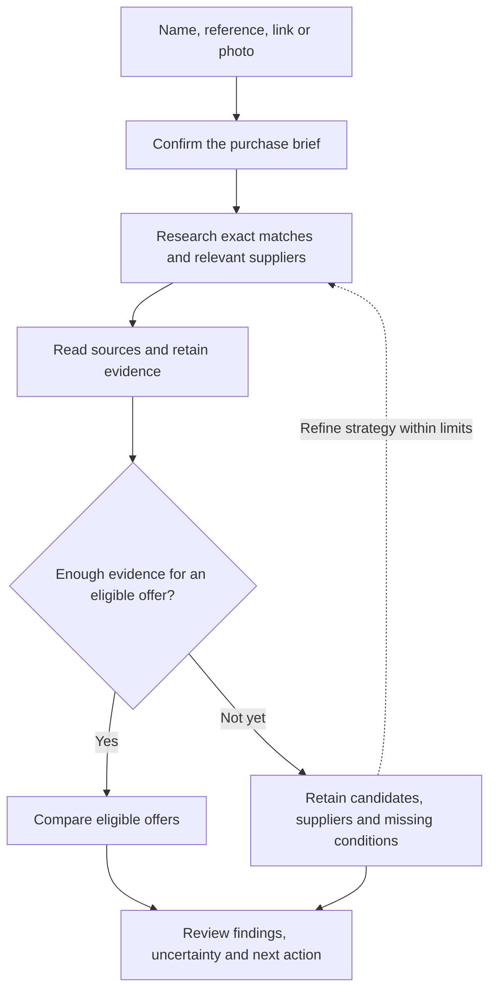
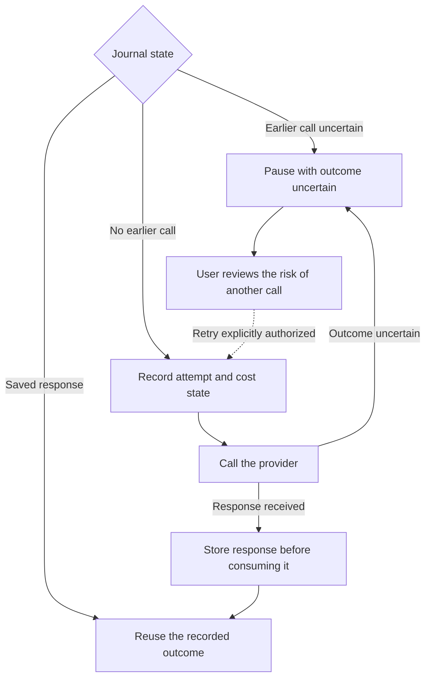
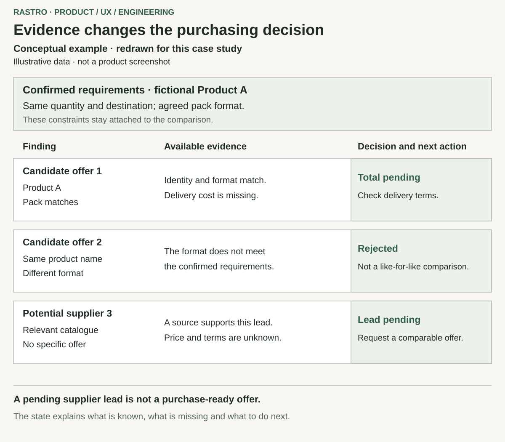

# Rastro: purchasing research with evidence and recovery

[Back to profile](../README.md) · [Español](rastro.es.md)

**Personal project · product definition, research UX and full-stack development**  
**Status snapshot: 29 October 2026**

Rastro is a local application for product and supplier research. It turns a name, reference, link or photograph into a purchase brief the user confirms, then presents findings with evidence and unresolved conditions. Its central challenge is explaining a decision when product identity, compatibility, delivery and costs remain uncertain.

The adaptive research engine, review interface and persistent execution are implemented, with historical verification records. Commercial usefulness and large real-world searches remain to be validated. The broader professional-procurement workflow is a documented next increment. Application source and purchasing records remain private.

## My responsibility

I defined the purchasing problems, priorities and criteria for useful results, then developed the application with AI-assisted research, design, implementation and review. My work includes translating practical buying failures into a purchase model, shaping the review experience and integrating durable execution. Models and provider services are external resources; this case does not attribute every algorithm or technique exclusively to me.

## The product problem

A similar name or a low advertised price does not establish a useful purchase. A component may be incompatible, a listing may describe a different pack, or transport and professional-access conditions may remain unknown. A relevant specialist may be worth contacting even without a priced offer.

The product therefore needs to preserve distinctions that a summary can hide: identity, compatibility, presentation and commercial eligibility. It should help the user understand the remaining question and next action, alongside the available evidence.

## Decisions that shaped the product

### 1. Define success around the buyer's actual purchase

I set the professional direction around improving a shop's comparable acquisition cost. A discount against a public retail price does not establish that improvement. The existing model already handles quantities, packs and some recurring conditions; the complete B2B workflow, including resale, volume scenarios and supplier quotations, remains pending. This decision gives the next increment a clear purpose without presenting that purpose as an achieved saving.

### 2. Confirm the purchase before researching it

The user reviews what is needed: the product or component, included and excluded items, quantity, acceptable formats, condition, destination and urgency. Sector-specific questions help distinguish a hairdressing product from a workshop part. This adds a confirmation step, but prevents the engine from treating an ambiguous input as a settled requirement. Identification can assist the user; it does not replace confirmation.

### 3. Keep candidates, suppliers and eligible offers distinct

Research can widen from exact matches to specialists, alternative sources and suppliers able to quote, according to findings and limits. I chose to retain useful leads with their missing conditions rather than give every discovered page an offer status. The report records sources, reasons and next actions; scoped knowledge and corrections retain review history. That creates more states to explain, but preserves why a result is usable, uncertain or rejected.

This simplified diagram explains the implemented research structure, not a guarantee that a search will find an eligible offer.

### 4. Compare the order while preserving unknown costs

The comparison accounts for complete packs, quantities, taxes, transport, minimums, currency and relevant conditions. A product price and a delivered order total have different meanings. Missing evidence leaves the corresponding total pending; a saving needs a comparable reference. This limits how often the interface can display a definitive answer, but makes the answer easier to assess. An exact calculation cannot compensate for an incorrect product match or an unconfirmed input.

### 5. Treat an uncertain paid call as a recovery decision

Research runs in a separate local worker with persistent jobs and a journal of paid operations. Known responses can be reused after interruption. When a provider may have charged but its response is missing, execution pauses instead of automatically repeating the call. A retry requires acknowledging that uncertainty and preserves the earlier reservation. This introduces a human recovery step in exchange for avoiding an unexamined duplicate expense.

The diagram is explanatory. Local accounting is estimated, not a provider billing cap, and recovery does not guarantee exactly-once remote effects. Cancelling a job cannot revoke a call already in flight.

## UX and implementation

The interface follows purchase-brief confirmation, investigation progress, report review and evidence inspection. Filters, rejection reasons and corrections help users investigate an answer. A quoted source passage supports provenance, not infallible interpretation; a local correction retains its scope.

These diagrams were redrawn for this case. They are explanatory examples, not screenshots of actual purchases or evidence of final visual acceptance.

The implementation combines a React interface, a Node.js API, a separate worker and SQLite persistence. AI-assisted identification and extraction sit alongside explicit purchase and comparison rules. The local worker uses an exclusive lease; this is a single-user application rather than a distributed queue or public service.

## Delivery state

| Part | State at this snapshot | Remaining boundary |
| --- | --- | --- |
| Purchase brief and review interface | Implemented with recorded local browser checks | Wider user acceptance and visual validation |
| Adaptive research, evidence and scoped knowledge | Implemented with local verification and small real trials | Independent commercial evaluation and broader source coverage |
| Order comparison | Quantity, pack and cost rules implemented | Quality of source inputs and complete professional-procurement scenarios |
| Persistent jobs and paid-call recovery | Implemented with recorded failure-path checks | Local scope; no distributed or exactly-once guarantee |
| B2B, resale, volume and supplier-quotation extension | Product direction and requirements documented | Complete implementation and validation; no autonomous negotiation |
| Public operation | Local single-user use | No public deployment or multi-user service claimed |

## Evidence and lessons

The latest implementation record is from 23 October; subsequent commercial requirements are dated 26 October. Historical checks cover behavior, database persistence, recovery and browser journeys. They were not rerun for this case. Offline development evaluations used synthetic examples and assisted labels, not an independent commercial benchmark.

The small real trials did not confirm fully eligible offers or a material purchasing saving in that sample. Real investigation across 200–300 pages and general commercial accuracy remain unvalidated. Those limits keep the case focused on product decisions, implemented behavior and what still needs testing.

The central lesson is to design the result and its uncertainty together: clarify the purchase, preserve supported findings and make the next decision visible.
