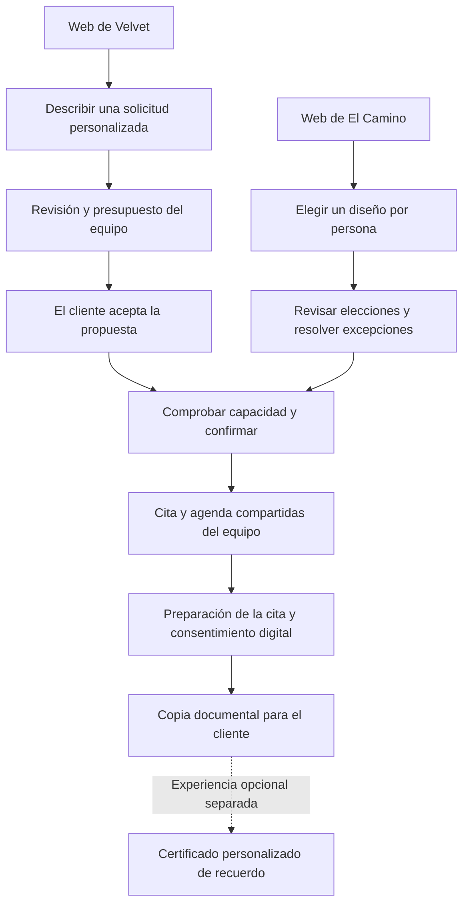
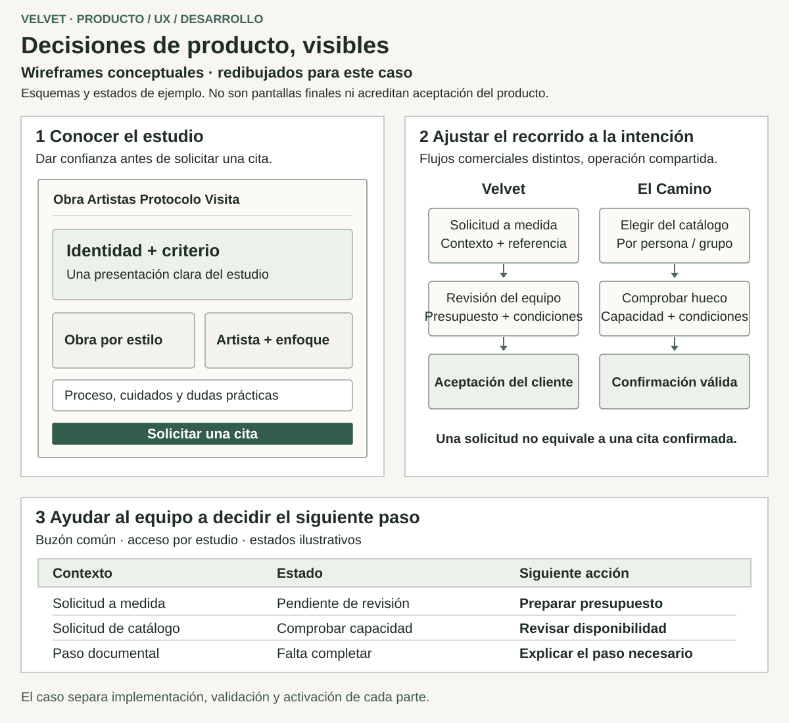
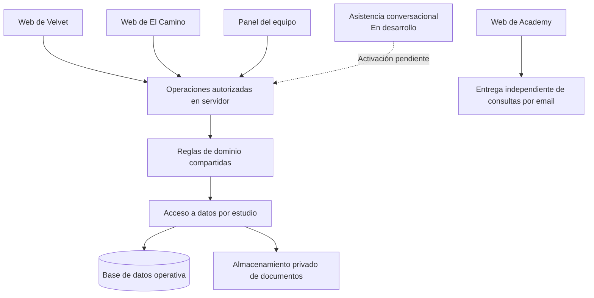

# Velvet: decisiones de producto, diseño y operación compartida

[Volver al perfil](../README.md) · [English](velvet.md)

**Proyecto para cliente · definición de producto, UX, dirección visual y desarrollo full-stack**  
**Fecha de corte: 27 de octubre de 2026**

Estoy desarrollando un ecosistema digital alrededor de Velvet Tattoo Studio, El Camino Tattoo y su academia. Mi trabajo conecta el posicionamiento ante sus públicos, los recorridos del cliente y las webs interactivas con las herramientas que permiten gestionar solicitudes, citas y documentos. Uno de los retos centrales es conservar la experiencia de cada marca y ofrecer al equipo un sistema coherente detrás.

La web informativa y de consultas de la academia está publicada. La plataforma de los estudios tiene una implementación importante y evidencia de integración local; su activación y aceptación operativa completas siguen en curso. Este caso explica decisiones y límites de entrega mediante documentación y diagramas redibujados. El código de las aplicaciones permanece privado.

## Mi responsabilidad

Trabajo en definición de producto, UX, dirección visual e implementación. Traduje conversaciones con el propietario y recepción en reglas y prioridades, exploré alternativas de diseño, dirigí el sistema visual y desarrollé interfaces públicas y recorridos operativos compartidos. También propuse ideas de producto, como un certificado personalizado conectado al recorrido digital.

Los negocios, servicios y conocimiento del sector pertenecen al cliente. Los requisitos y contenidos proceden del cliente y del equipo; algunas decisiones fueron mías y otras se acordaron o refinaron con ellos. Utilicé asistencia de IA para investigación, prototipado, implementación y revisión, junto con librerías y componentes existentes. Mi aportación incluye seleccionar, adaptar e integrar esos recursos, conservando las decisiones y su verificación durante el desarrollo.

## El problema de producto

Los dos estudios atienden situaciones diferentes. Velvet se dirige a clientes locales que valoran trabajos personales, en ocasiones de mayor elaboración. El Camino atiende a un público peregrino internacional, incluidos grupos que eligen diseños individuales para una visita compartida. La academia introduce un tercer recorrido: comprender una oferta formativa y realizar una consulta informada.

Una presencia digital útil debe explicar la oferta adecuada, generar confianza y aclarar el siguiente paso. Después, el equipo necesita contexto para actuar: qué estudio, qué persona o grupo, qué se ha solicitado, qué necesita revisión y qué está realmente confirmado. Estas necesidades dieron forma tanto a la experiencia pública como a las herramientas internas.

## Decisiones que dieron forma al producto

### 1. Experiencias de marca distintas con una operación compartida

Elegí webs, contenidos y recorridos separados para los dos estudios. Una única web indiferenciada habría simplificado la presentación, pero habría debilitado la distinción entre el trabajo personalizado local y la experiencia del peregrino. Los componentes y las reglas operativas compartidos permiten reutilizar recursos, mientras la composición de cada marca permanece separada. La contrapartida es mantener varias experiencias sin que sus datos o reglas de negocio diverjan accidentalmente.

### 2. Adaptar el recorrido al tipo de cita

Velvet conserva un recorrido de solicitud, revisión y presupuesto cuando el trabajo lo requiere. El Camino permite elegir piezas de catálogo por persona, también dentro de un grupo, y la confirmación depende de resolver las elecciones y disponer de capacidad. Elegí un sistema de citas común frente a agendas separadas para cada interfaz o canal. Esto introduce transiciones de estado explícitas y permite al equipo distinguir una solicitud recibida de una cita acordada y confirmada.

El diagrama representa el recorrido diseñado. Los flujos de los estudios siguen sujetos al trabajo de integración y activación descrito más adelante.

### 3. Permitir revisar las elecciones antes de comprometerse

Diseñé el recorrido del catálogo alrededor de una elección individual para cada miembro del grupo, un resumen revisable y unos siguientes pasos explícitos. Un grupo implica más que indicar una cantidad sobre un mismo diseño: sus integrantes pueden elegir piezas distintas o necesitar revisión individual. El mismo principio aparece en las consultas de Academy, donde se puede revisar y editar la información antes de enviarla. Esto exige gestionar más estados que un simple botón de contacto, pero conserva el contexto y aclara qué significa el envío.

### 4. Conectar una idea de producto con un recorrido útil

Propuse generar un certificado personalizado del peregrino desde el recorrido digital, convirtiendo una idea de recuerdo en una experiencia apoyada por software. Su presentación está separada de la constancia del consentimiento y la participación es opcional. La ingeniería requiere seleccionar los datos de forma controlada y generar documentos; un recuerdo que se puede compartir no debe exponer datos sensibles del consentimiento ni información de la cita ajena a ese recuerdo. La generación está implementada, mientras el ciclo completo de entrega real conserva condiciones pendientes. Los posibles beneficios en ventas, difusión y retorno de clientes siguen siendo hipótesis, no resultados medidos.

### 5. Entregar la base operativa antes de activar la automatización conversacional

Prioricé las webs de los estudios, el panel compartido y el recorrido de citas antes de activar chatbots. Las comunicaciones transaccionales de citas conservan sus propios requisitos. Las futuras entradas conversacionales deben utilizar las mismas operaciones autorizadas y reglas de capacidad, con derivación a una persona, en lugar de crear otro sistema de reservas. Así se conserva la visión del conjunto y se mantiene identificable la primera entrega operativa.

## UX, prototipado y dirección visual

Exploré alternativas de apertura, estructuras de galería y presentaciones del protocolo mediante prototipos editables. Después utilicé pantallas representativas de escritorio y móvil para decidir el sistema visual. Mi trabajo incluye tipografía y jerarquía, composición de marca, exploración de obras, inspección de imágenes, navegación y transición del descubrimiento a la solicitud.

Los elementos interactivos de la galería se seleccionan y adaptan a la tarea, con alternativas táctiles, comportamiento de teclado y tratamiento del movimiento reducido en la implementación. Una apertura centrada en la marca y un panel que el equipo utiliza con frecuencia necesitan énfasis distintos: el panel prioriza estado, responsabilidad y siguiente acción. La navegación, las rutas localizadas y las páginas de servicios también comparten una estructura de información coherente.

Estos wireframes esquemáticos se redibujaron para este caso. Ilustran las responsabilidades de cada superficie; no son los prototipos originales, capturas de producción ni evidencia de aceptación visual final.

## Arquitectura y límites de entrega

Las aplicaciones de los estudios comparten reglas de dominio en TypeScript y acceso a datos en servidor, con autorización según el actor y el estudio. La implementación utiliza Next.js/React, PostgreSQL, Drizzle y almacenamiento privado de documentos. Los recursos de UI compartidos sirven de base a composiciones de marca diferentes. Academy tiene actualmente una entrega independiente de información y consultas; pertenecer al mismo conjunto no implica que su integración técnica esté terminada.

Las conexiones continuas del diagrama describen la estructura implementada de los estudios y el recorrido separado de Academy. La conexión discontinua representa la dirección de integración conversacional, con activación en producción pendiente.

| Parte | Estado en esta fecha de corte | Límite pendiente |
| --- | --- | --- |
| Experiencias públicas de Velvet y El Camino | Implementadas, con evidencia de preview y revisión local | Entrega final, aceptación visual y activación operativa |
| Panel compartido, solicitudes, presupuestos y agenda | Implementados e integrados localmente, con evidencia focal y de CI | Comprobaciones completas en destino, aceptación del equipo y operación real |
| Consentimiento digital, copias documentales y generación de certificados | Implementados con evidencia de integración y comportamiento ante fallos | Flujo final con datos reales, contenido aplicable y aceptación operativa |
| Información y consultas de Academy | Publicadas de forma independiente; entrega de consultas documentada | Integración con el conjunto y alcance editorial restante; no se presenta como sistema de matrículas o pagos |
| Asistencia conversacional | Núcleo común y trabajo de servicio web implementados en desarrollo | Integración persistente y activación en producción; los bots no se presentan como operativos |

## Evidencia y aprendizajes

El trabajo está respaldado por decisiones fechadas, iteraciones de prototipos, revisión de fuentes, pruebas focales de comportamiento, comprobaciones de integración con la base de datos y registros de CI. Estas comprobaciones cubren versiones y límites concretos; no acreditan aceptación completa en producción, conformidad universal de accesibilidad ni resultados comerciales medidos.

El principal aprendizaje es hacer visibles las distinciones del negocio tanto en la experiencia como en la implementación: presentación por público, solicitud frente a confirmación, elecciones individuales dentro de un grupo e implementación frente a operación. Esa conexión entre criterio de producto, diseño e ingeniería es la aportación que este caso busca mostrar.

Ejemplo público: [web informativa de Velvet Academy](https://velvettattooacademy.es/).
