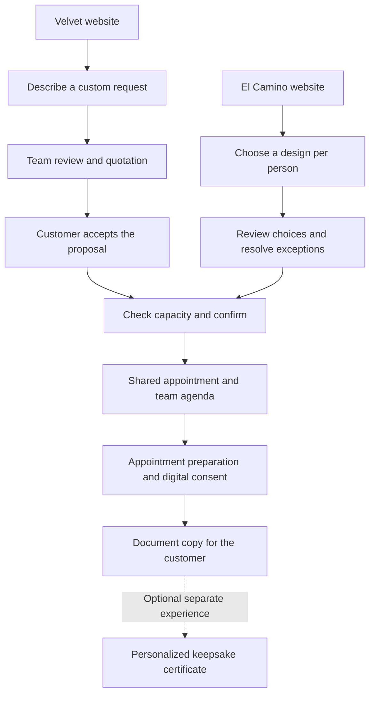
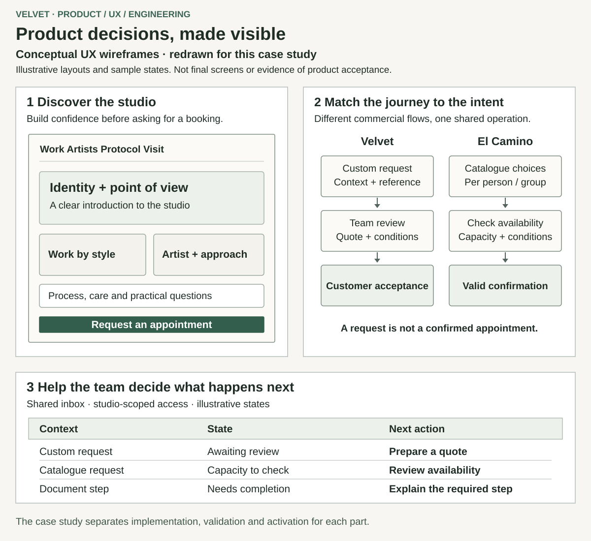
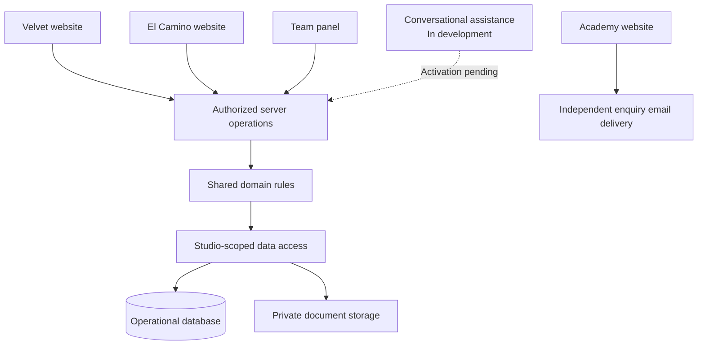

# Velvet: product decisions, design and shared operations

[Back to profile](../README.md) · [Español](velvet.es.md)

**Client project · product definition, UX, visual direction and full-stack development**  
**Status snapshot: 27 October 2026**

I am developing a digital ecosystem around Velvet Tattoo Studio, El Camino Tattoo and their related academy. My work connects audience positioning, customer journeys and interactive websites with the operational tools used to handle requests, appointments and documents. A central challenge is preserving each brand's experience while giving the team a coherent system behind it.

The academy's information and enquiry website is live. The wider studio platform has substantial implementation and local integration evidence; its complete operational activation and acceptance remain in progress. This case explains decisions and delivery boundaries through documentation and redrawn diagrams. The application source remains private.

## My responsibility

I work across product definition, UX, visual direction and implementation. I translated conversations with the owner and reception team into rules and priorities, explored design alternatives, directed the visual system and developed public interfaces and shared operational workflows. I also proposed product ideas such as a personalized certificate connected to the digital journey.

The businesses, services and domain knowledge belong to the client. Requirements and content came from the client and team; some decisions were mine, others were agreed or refined with them. I used AI-assisted research, prototyping, implementation and review, alongside established libraries and components. My contribution includes selecting, adapting and integrating those resources, with decisions and verification recorded during development.

## The product problem

The two studios serve different situations. Velvet supports local customers considering personal, sometimes more involved work. El Camino serves an international pilgrim audience, including groups choosing individual designs around a shared visit. The academy introduces a third journey: understanding a training offer and making an informed enquiry.

A useful digital presence needs to explain the right offer, build confidence and make the next action clear. The team then needs enough context to act: which studio, which person or group, what has been requested, what needs review and what is actually confirmed. Those needs shaped both the public experience and the internal tools.

## Decisions that shaped the product

### 1. Distinct brand experiences with shared operations

I chose separate websites, content and journeys for the two studios. A single undifferentiated site would have made the presentation simpler, but weakened the distinction between local custom work and the pilgrim experience. Shared components and operational rules provide reuse, while brand composition remains separate. The trade-off is maintaining multiple experiences without allowing their data or business rules to diverge accidentally.

### 2. Match the journey to the kind of appointment

Velvet retains a request, review and quotation path where the work requires it. El Camino supports catalogue choices per person, including within a group, and confirmation depends on resolved choices and available capacity. I chose a common appointment system rather than separate agendas for each interface or channel. This adds explicit state transitions, but lets the team distinguish a received request from an agreed and confirmed appointment.

The diagram shows the designed journey. The studio flows remain subject to the integration and activation work described below.

### 3. Let people review their choices before committing

I designed the catalogue journey around an individual choice for each group member, a reviewable summary and explicit next steps. A group is more than a quantity attached to one design: people may select different pieces or need individual review. The same principle appears in Academy enquiries, where visitors can review and edit their information before submission. This requires more state handling than a simple contact button, but preserves context and makes the meaning of submission clearer.

### 4. Connect a product idea to a useful workflow

I proposed generating a personalized pilgrim certificate from the digital workflow, turning a loose keepsake idea into a software-supported experience. Its presentation is separate from consent evidence, and participation is optional. The engineering needs include controlled data selection and document generation; it should not expose sensitive consent data or unrelated appointment information in a shareable keepsake. Generation is implemented, while the full real-world delivery cycle retains pending conditions. Sales, sharing and customer-return benefits remain hypotheses rather than measured outcomes.

### 5. Deliver the operational foundation before conversational automation

I prioritized the studio websites, shared panel and appointment workflow ahead of activating chatbots. Transactional appointment communications retain their own requirements. Future conversational entry points should use the same authorized operations and capacity rules, with a human handoff, rather than create another booking system. This preserves the broader vision while keeping the first operational delivery identifiable.

## UX, prototyping and visual direction

I explored alternative openings, gallery structures and protocol presentations through editable prototypes, then used representative desktop and mobile screens to decide the visual system. My work includes typography and hierarchy, brand composition, artwork browsing, image inspection, navigation and the transition from discovery to a request.

Interactive gallery elements are selected and adapted for the task, with touch alternatives, keyboard behavior and reduced-motion handling in the implementation. A brand-led opening and a frequently used team panel need different emphasis: the panel prioritizes status, responsibility and next action. Navigation, localized routes and service pages also share a consistent information structure.

These schematic wireframes were redrawn for this case. They illustrate the responsibilities of the surfaces; they are not the original prototypes, production screenshots or evidence of final visual acceptance.

## Architecture and delivery boundaries

The studio applications share TypeScript domain rules and server-side data access, with authorization scoped to the actor and studio. The implementation uses Next.js/React, PostgreSQL, Drizzle and private document storage. Shared UI resources sit underneath distinct brand compositions. Academy currently has an independent information-and-enquiry delivery; shared ownership does not imply a completed technical integration.

Solid connections below describe the implemented studio structure and Academy's separate route. The dashed connection represents the conversational integration direction, with production activation pending.

| Part | State at this snapshot | Remaining boundary |
| --- | --- | --- |
| Velvet and El Camino public experiences | Implemented, with preview and local review evidence | Final delivery, visual acceptance and operational activation |
| Shared panel, requests, quotations and agenda | Implemented and integrated locally, with focused and CI evidence | Complete destination checks, team acceptance and real operation |
| Digital consent, document copies and certificate generation | Implemented with integration and failure-path evidence | Final real-data flow, applicable content and operational acceptance |
| Academy information and enquiries | Independently published; enquiry delivery documented | Wider platform integration and remaining editorial scope; no enrolment or payment system claimed |
| Conversational assistance | Common core and web-service work implemented in development | Durable integration and production activation; bots are not presented as operational |

## Evidence and lessons

The work is supported by dated decisions, prototype iterations, source review, focused behavior tests, database integration checks and CI records. Those checks cover specific versions and boundaries; they do not establish complete production acceptance, universal accessibility compliance or measured commercial results.

The main lesson is to make business distinctions visible in both experience and implementation: audience-specific presentation, request versus confirmation, individual choices within a group, and implementation versus operation. That connection between product judgment, design and engineering is the contribution this case aims to show.

Public example: [Velvet Academy information website](https://velvettattooacademy.es/).
